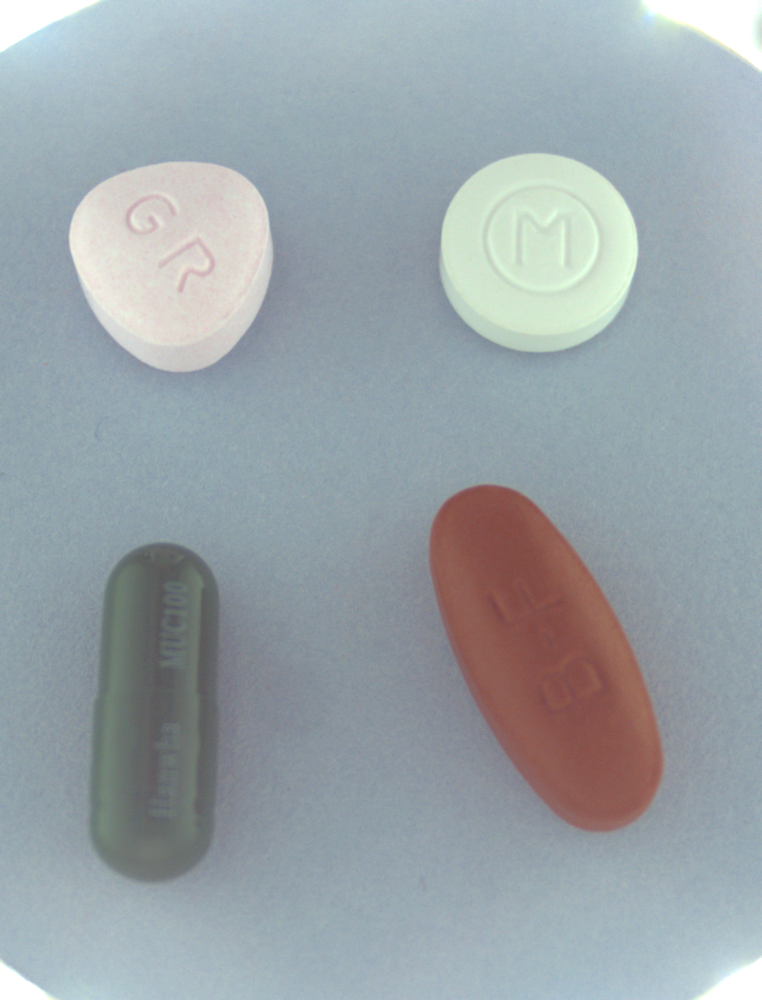
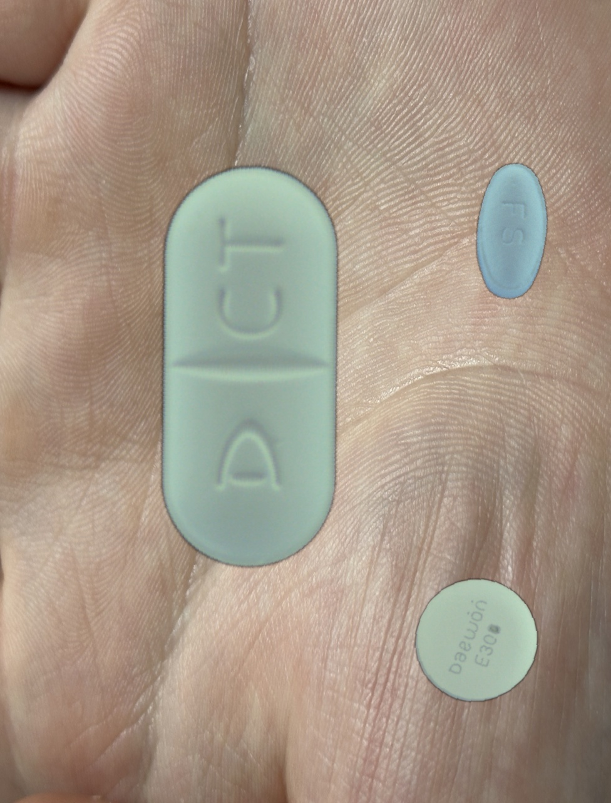
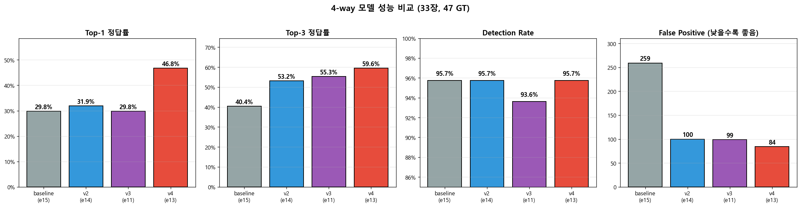
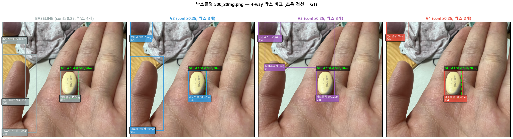
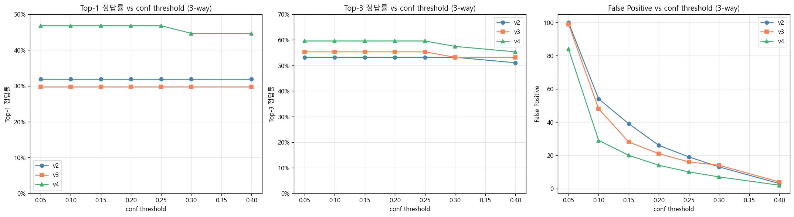
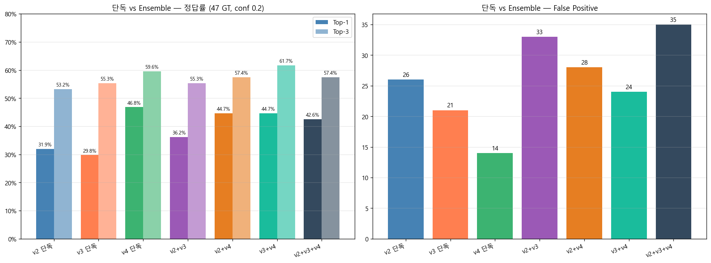
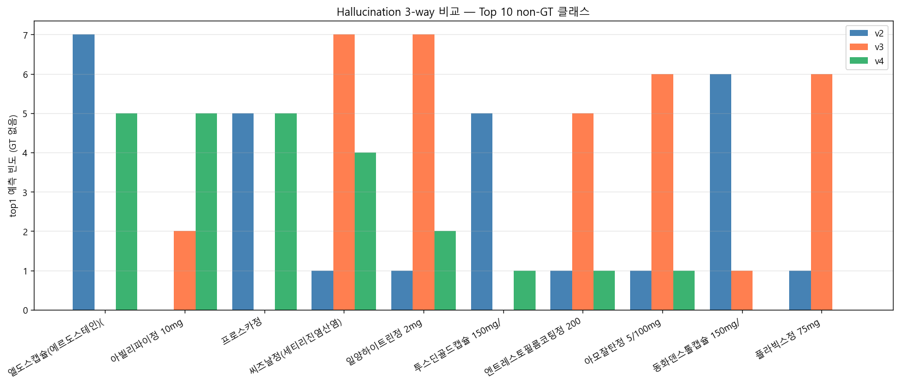
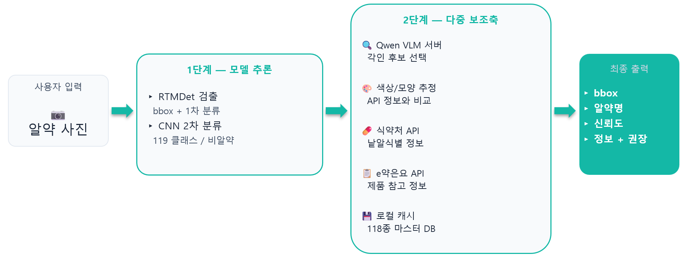

# HealthEat: 알약 탐지·분류 시스템

3팀 보고서 (RTMDet 탐지 트랙)

2026-10-25 정답 라벨 오기1건(두 박스)을 수정했다. 3.5·6.2·8.1의 대표 평가표는 네 모델의 저장 예측을 같은 **GT v2**로 재채점한 값이다. v4는 정정 후 **24/47(51.1%)**, 저장 가중치의 별도 실행에서는 **25/47**을 확인했다. 환경별·앙상블·전이 분석과 기존 그림은 재집계하지 않아 해당 절에 **당시 GT v1 분석**으로 표시했다. 원본 예측·그림·학습 로그는 보존했다([정오표](errata_label_v2_20261024/README.md)).

---

## 목차

1. [프로젝트 개요](#1-프로젝트-개요)
2. [데이터: 통합, 정제, 자체 평가셋](#2-데이터-통합-정제-자체-평가셋)
3. [모델 비교: 8개 후보에서 RTMDet-tiny 선정](#3-모델-비교-8개-후보에서-rtmdet-tiny-선정)
4. [합성 데이터 진화: baseline → v2 → v3](#4-합성-데이터-진화-baseline--v2--v3)
5. [Phase A 백본 진단: Two-Stage 구조가 필요한 이유](#5-phase-a-백본-진단-two-stage-구조가-필요한-이유)
6. [v4 학습 설정 변경과 4-way 평가](#6-v4-학습-설정-변경과-4-way-평가)
7. [시스템 구조: 배포 트랙과 분석 트랙 분리](#7-시스템-구조-배포-트랙과-분석-트랙-분리)
8. [결과, 한계, 개선방안](#8-결과-한계-개선방안)

---

## 1. 프로젝트 개요

### 1.1 서비스 시나리오

HealthEat은 사용자가 스마트폰으로 알약 사진을 찍으면 AI가 위치를 탐지하고 약품명·효능·복용법을 알려주는 헬스케어 웹 서비스다. 약 봉투를 잃어버렸거나, 어떤 약인지 확인이 필요한 상황에서 사용자가 직접 검색하지 않아도 되도록 한다.

### 1.2 평가축 두 가지

본 프로젝트는 평가축을 두 개로 나누어 사용했다. 둘은 측정 대상 자체가 다르므로 어느 한 쪽 점수만으로 모델을 판단하면 오해를 부를 수 있다.

| 평가축 | 대상 | 측정 의미 |
|---|---|---|
| Kaggle 점수 (mAP@[0.75:0.95]) | 학습 분포와 동일한 도메인 (스튜디오 촬영) | 도메인 내부 정합도 |
| 33장 자체 평가셋 (Top-1 / Top-3 / Detection / FP) | 촬영 환경 7가지 (palm·cloth·desk·paper·bottle·dark·box) | 스튜디오 밖 촬영 조건의 재사용 평가 |

학습 데이터는 모두 AI Hub 경구약제 이미지 데이터셋 기반이다. 흰 배경, 균일 조명, 정면 촬영이다. 실 사용자가 손바닥에 올려 찍거나 어두운 책상 위에서 찍은 사진은 분포 자체가 다르다. Kaggle 점수가 99% 가까이 나와도 실 사용에서는 30%대로 떨어진다.

이 격차를 직접 측정하기 위해 팀이 자체 촬영한 33장 47 GT 평가셋을 별도 트랙으로 운영했다.

### 1.3 한국 알약 공개 평가 데이터 부재

경량 모델과 사용자 사진 기반 알약 탐지를 다룬 한국어 공개 자료는 다음 7경로를 확인한 범위에서 찾지 못했다.

1. AI Hub: 학습용 데이터만 공개, 평가셋 별도 없음
2. 식약처: 알약 식별 API는 있으나 이미지 데이터셋 미공개
3. Kaggle 한국 알약 데이터셋: 본 프로젝트가 사용한 1개 외 추가 없음
4. 학술 논문 (KCI / 한국정보과학회): 알약 탐지 관련 한국어 논문 0건
5. GitHub 한국 알약 프로젝트: 공개된 사례 거의 없음
6. 헬스케어 스타트업 공개 자료: 의료 도메인 데이터 비공개 정책
7. 우회(미국 NLM Pillbox): 한국 약과 모양·각인 매핑 안 됨

따라서33장 자체 평가셋으로 스튜디오 밖 촬영 조건을 비교했다. 모델과 점수 기준 선택에도 이 자료를 사용했으므로 독립된 새 이미지의 일반화 성능과는 구분한다. 환경을7가지로 나눠 오류를 살폈다.

### 1.4 설계 우선순위

알약 오인은 의료 사고 위험을 동반한다. 정확도 1~2pp 차이보다 오탐(False Positive) 최소화, 다중축 검증, 사용자 마지막 확인이 더 중요하다는 판단으로 시스템을 설계했다.

---

## 2. 데이터: 통합, 정제, 자체 평가셋

### 2.1 원천 데이터

| 출처 | 클래스 | 이미지 | 비고 |
|---|---|---|---|
| AI Hub 경구약제 이미지 데이터셋 | 메인 | 다중 각도/조명 | 메인 학습 입력 |
| Kaggle pill detection (한국 알약) | 보조 | 추가 표본 | 클래스 매핑 후 통합 |

총 118 클래스를 통합했다. 두 데이터셋 모두 스튜디오 환경 촬영이다(흰/회색 배경, 균일 조명).

### 2.2 5인 EDA 교집합 4가지 제거 기준

5인이 각자 EDA를 진행하고 이슈를 모은 뒤, 5인 모두 동의한 사항만 팀 공통 전처리에 반영했다.

1. **명백한 오류 bbox**: `w≤0`, `h≤0`, `area≤0`, `area NaN`
2. **bbox 경계 초과**: bbox가 이미지 범위(976×1280) 밖
3. **좌표 완전 중복**: 같은 이미지 내 4좌표 동일
4. **라벨 누락/오류**: set 비교 + 같은 클래스 중복 라벨

5인 합의가 안 된 이슈(예: bbox 작은 케이스, 회전 정도 차이)는 개별 판단으로 분기 가능하도록 보존했다. 강제 제거하면 다른 팀원의 학습 트랙에 영향이 가기 때문.

자세한 5인 이슈 리스트와 교집합 도출 과정은 [`docs/eda/`](eda/) 참조.

### 2.3 Split: Combo Group으로 누수 차단

`sklearn.model_selection.GroupShuffleSplit` 사용:

```python
groups       = combo (이미지 단위 그룹)
test_size    = 0.2
random_state = 42
```

combo 단위 split으로 train/val 간 image overlap 0건 + combo overlap 0건 보장. 같은 약의 다른 각도 사진이 train/val에 갈라져 들어가는 누수를 차단한다.

### 2.4 산출물

| 자료 | 수치 |
|---|---|
| `clean_df.csv` | annotation 39,864개 / images 10,392장 |
| `train.txt` / `val.txt` | YOLO 학습 입력 |
| `pill.yaml` | 118 클래스 매핑 |

전처리/Split 완료된 학습 데이터는 HuggingFace Hub에서도 받을 수 있다.

- [`wony98/healtheat-pill-yolo`](https://huggingface.co/datasets/wony98/healtheat-pill-yolo): 118 classes / YOLO 포맷

### 2.5 33장 자체 평가셋: 실 사용자 환경

학습 데이터의 도메인 격차를 직접 측정하기 위해 팀이 자체 촬영한 33장 / 47 GT 평가셋을 운영했다.

| 환경 | n (GT 단위) |
|---|---|
| palm (손바닥) | 20 |
| cloth (천 위) | 10 |
| paper (종이 위) | 7 |
| desk (책상) | 5 |
| bottle (병 위) | 2 |
| dark (어두운 환경) | 2 |
| box (박스) | 1 |
| 합계 | 47 GT / 33장 |

평가 메트릭: Top-1 / Top-3 / Detection rate / False Positive 4지표. IoU 0.5 매칭 후 분류 정답 채점.

---

## 3. 모델 비교: 8개 후보에서 RTMDet-tiny 선정

### 3.1 후보 8개

| 모델 | 패밀리 | 파라미터 | 특징 |
|---|---|---|---|
| YOLOv8n | YOLO | 3.2M | 가장 작음, 베이스라인 |
| YOLOv8s | YOLO | 11.2M | 균형 |
| YOLO11n | YOLO | 2.6M | 최신 경량 |
| YOLO9c | YOLO | 25.5M | 큰 모델 |
| YOLOX-s | YOLO | 9.0M | anchor-free |
| Faster R-CNN v2 | Two-stage | 41M+ | 정확도 강조 |
| RF-DETR | DETR | — | 효율 DETR |
| RT-DETR | DETR | — | 실시간 DETR |
| RTMDet-tiny | RTMDet | 4.9M | OpenMMLab 경량 탐지 |

### 3.2 4단계 재현성 검증

각 후보를 동일한 train/val split + seed로 학습 후, 다음 4단계로 재현성을 검증했다.

1. **시드 고정 학습**: seed=42 / seed=100 두 번 학습, 결과 분포 확인
2. **best epoch 안정성**: best epoch이 학습 후반에 위치하는지 (조기 수렴은 데이터 부족 신호)
3. **val mAP 천장 확인**: val mAP 곡선이 도달 후 평탄해지는지 (overshoot 없는지)
4. **inference 시간 측정**: GPU + CPU 양쪽

### 3.3 5단계 깊이 비교 (후보 3개 추렸을 때)

상위 3개 후보(RTMDet-tiny / RT-DETR / YOLOv8s)에 대해 더 깊은 비교를 진행했다.

1. **33장 일반화 점수**: 도메인 시프트 견고성
2. **오탐(FP) 분포**: 위치 / 클래스 / conf 분포
3. **오답 패턴 매트릭스**: 의미있는 혼동 / 무작위 / 미분류 분류

오답 패턴 매트릭스 결과:

| 모델 | 의미있는 혼동 | 무작위 | 미분류 | 합계 |
|---|---|---|---|---|
| RTMDet-tiny | 28 | 1 | 1 | 30 |
| YOLOv8s | 8 | 0 | 21 | 29 |
| RT-DETR | 8 | 0 | 25 | 33 |

**해석**: RTMDet-tiny의 오답은 시각적으로 비슷한 알약 간 혼동이 대부분(28/30, 93.3%)이다. 모델이 시각 특성을 학습하고 있다는 증거다. 반면 YOLOv8s/RT-DETR은 미분류(클래스 자체를 못 맞춤)가 대부분이다.

4. **신뢰성 검증 3중 통과**
   - mode collapse 없음 (특정 클래스로 쏠리는 현상)
   - 의미있는 혼동 28/30 (93.3%)
   - 누수 0건 (combo split 검증)

5. **추론 비용**
   - GPU: 132.1ms/image
   - CPU (HF Spaces 2 vCPU): 1.03초/image, 웹 데모 실시간 사용 가능

### 3.4 선정 결과: RTMDet-tiny

RTMDet-tiny (4.9M, OpenMMLab)를 메인 탐지 모델로 확정했다. 경량 구조인데도 5단계 깊이 비교에서 재현성, 일반화, 신뢰성 모두 후보 중 가장 좋았다.

> 자세한 후보 3개 깊이 비교는 [`docs/model_selection/model_comparison.md`](model_selection/model_comparison.md) 참조.

### 3.5 두 평가축 차이: Kaggle vs 33장

선정한 RTMDet-tiny를 두 평가축에서 비교한 결과 격차가 크게 나타났다.

| 평가축 | baseline | v4 | 차이 |
|---|---|---|---|
| Kaggle mAP@[0.75:0.95] | 0.969 | 0.957 | -0.012 |
| 33장 Top-1, GT v2 저장 예측 재채점 | 29.8% (14/47) | 51.1% (24/47) | +21.3pp |

**해석**:
- Kaggle 기록에서는 baseline 점수가 더 높고,33장 GT v2 재채점에서는 v4 저장 예측이 더 많은 정답을 맞혔다.
- v4는 여러 학습 조건을 함께 바꿨으므로 위 차이를 augmentation 한 가지의 효과로 보지는 않는다. 라벨 정정으로 달라진 점수도 모델 개선과 구분한다.
- 두 점수는 측정 대상이 다르다. 어느 한 쪽만 보면 잘못된 결정으로 이어진다.

---

## 4. 합성 데이터 진화: baseline → v2 → v3

### 4.1 왜 만들었나: 도메인 시프트 가설

원본 데이터는 모두 스튜디오 환경. 실 사용자 사진과 분포가 크게 다르다.

| 차원 | 원본 (AI Hub + Kaggle) | 실 사용자 |
|---|---|---|
| 배경 | 흰/회색 단색 | 손바닥, 천, 종이, 책상, 박스, 어두운 환경 |
| 조명 | 균일 | 가변 (그림자, 역광, 어두움) |
| 거리 | 일정 | 가까이/멀리 |
| 알약 개수 | 1개 | 1~5개 (사용자가 한 번에 찍음) |

**가설**: 누끼 딴 알약을 다양한 배경 위에 합성해 학습 데이터 다양성을 확보하면, 실 사용 환경 일반화가 개선된다.

 

### 4.2 어떻게 만들었나: 3단계 흐름

1. **누끼 따기**: `rembg` (`isnet-general-use` 모델) 로 GT bbox crop의 배경 제거
2. **배경 풀 구성**: 직접 촬영 + 크롤링 + 육안 선별
3. **합성**: 누끼 + 배경 + 라벨 자동 생성

주요 파라미터:

```python
IMG_W, IMG_H         = 976, 1280
MIN_PILLS, MAX_PILLS = 2, 4 (v3는 1, 4)
MARGIN               = 30          # 경계 여백 (px)
MIN_ALPHA_RATIO      = 0.35        # 누끼 품질 기준
MAX_PILL_AREA_POST   = 0.30 → 0.20 # 회전 후 면적 제한 (v3에서 강화)

# 씬 단위 global_scale (같은 이미지 내 모든 알약에 동일 적용)
global_scale = random.uniform(0.9, 1.1)
# → 촬영 거리 통일성 보장 (먼지 옆 거대 캡슐 같은 비현실적 합성 차단)

# 조명 보정 (HSV)
ratio = np.clip(bg_brightness / pill_brightness, 0.85, 1.15)
# V(명도)만 조절, H(색상)/S(채도) 유지
# → 약 식별에서 색상이 핵심 지표이므로 색상/채도는 절대 수정하지 않음
```

### 4.3 진화 흐름

| 버전 | 카운트 | 배경 풀 | 핵심 변경 |
|---|---|---|---|
| baseline (통합본) | 1,800 + 200 (val) | 직촬 10장 | 1차 시도 |
| baseline 확장 | 7,200 + 800 = 8,000 | 199장 (직촬 10 + 크롤링 189) | 배경 다양성 확보 |
| v2 | 7,194 + 800 = 7,994 | 199장 동일 | 양질 lognormal 분포 매칭, 1~5개 가중 샘플링 |
| v3 | 6,509 + 800 = 7,309 | 233장 (palm 6→42장) | palm 마스크 + 100px 침식, MAX_PILL_AREA_POST 0.20 |

**v2 → v3 알약 개수 가중치**:
```python
PILL_COUNT_WEIGHTS = {1: 0.135, 2: 0.429, 3: 0.311, 4: 0.124}
```

v3 알약 분포 결과 (셀 18 검증 출력):
- 이미지 7,309장 / annotation 16,488개 / 이미지당 평균 2.26개
- 1개 21.1% / 2개 40.8% / 3개 29.3% / 4개 8.7%

### 4.4 v3 palm 마스크 개선: 손바닥 환경 정밀화

백본 진단 결과 palm 환경 정답률이 30%로 정체했다. 합성 차원에서 palm 풀을 확장하고 마스크 침식으로 정밀화했다.

**palm 풀 6 → 42장**:
- Nano Banana 생성형 50장 시도 → 마스크 검수 후 8장 폐기 → 42장 채택
- 손가락 매크로 / 베이지 배경 + 어두운 손 등 다양화

**palm 마스크 + 100px 침식**:
- `rembg` `u2net_human_seg` 모델로 손 영역 마스크 생성 (`isnet-general-use`는 손 분리 실패)
- 50px 침식 → 외곽 12pp만 깎임 (손가락 두께 70~100px 미만)
- 100px 침식 → 손가락 끝 1마디 깎임 (mean 39% → 14%), 손가락 위 알약 차단
- 효과: 알약이 손바닥 중앙 위주로 떨어지는 합성 (실 사용자 사진 패턴 매칭)

**MAX_PILL_AREA_POST 0.50 → 0.20**:
- 회전 후 면적 제한 강화 → 거대 알약 컷 차단 → 현실성 확보

자세한 진화 흐름은 [`docs/synthesis_evolution/synthesis_v1_v2_v3.md`](synthesis_evolution/synthesis_v1_v2_v3.md) 참조.

### 4.5 외부 자료: HuggingFace Hub

용량 문제로 GitHub에 직접 포함하지 않은 합성 데이터셋은 HuggingFace Hub에 업로드되어 있다.

| 저장소 | 내용 |
|---|---|
| [`wony98/healtheat-pill-synthetic-baseline`](https://huggingface.co/datasets/wony98/healtheat-pill-synthetic-baseline) | 통합본 8,000장 (RTMDet baseline 학습 입력) |
| [`wony98/healtheat-pill-synthetic-v3`](https://huggingface.co/datasets/wony98/healtheat-pill-synthetic-v3) | v3 7,309장 (palm 풀 42장 + 마스크 + v4 학습 입력) |

---

## 5. Phase A 백본 진단: Two-Stage 구조가 필요한 이유

### 5.1 동기: val 99% vs 33장 30% 격차

baseline 학습 결과 다음 격차가 측정됐다.

| 평가축 | mAP@50 / Top-1 |
|---|---|
| val mAP@50 | 0.99+ (천장 수준) |
| 33장 Top-1 | 29.8% |
| 격차 | 약 70pp |

당시 GT v1 채점에서는 baseline29.8%, 합성 데이터 v2는31.9%였다. 이 결과를 바탕으로 아래 백본 진단을 진행했다. 현재 GT v2 재채점 값은6.2 표에 따로 정리했다.

### 5.2 Phase A 5단계 진단

원인을 데이터/학습/모델 중 어느 차원의 문제인지 정확히 짚기 위해 5단계로 진단했다.

| 단계 | 측정 | 결과 |
|---|---|---|
| 1 | 학습 곡선: train loss vs val loss 발산 여부 | 정상, 발산 0 |
| 2 | val Top-1: val 안에서도 어려운 케이스가 있는지 | val Top-1도 99%. val은 학습 분포 그대로라 변별 검증 한계 |
| 3 | confusion matrix: 페어 클래스 (시각 유사) 혼동 패턴 | 페어 1/2/3 라벨 100% 수렴 (한 방향으로 완전히 쏠림) |
| 4 | attention (Grad-CAM): 모델이 알약의 어느 부분을 보는지 | ClassConditionalGradCAM (forward + full backward hook on neck), 페어 클래스 70 케이스 |
| 5 | head 분리도: feature 공간에서 페어 클래스가 분리되는지 | cos_sim 0.992 (100% > 0.95) |

### 5.3 발견: 백본이 페어 클래스를 구분하지 못함

**페어 클래스 70 케이스 cos_sim 분포**:
- 평균 0.992
- 100%가 cos_sim > 0.95 (모든 케이스가 거의 동일한 feature 벡터)

**해석**: 백본이 시각적으로 비슷한 페어 클래스를 feature 공간에서 거의 구분하지 못한다. detection은 잘 잡지만 분류는 페어 안에서 한 쪽으로만 쏠린다 (라벨 이동 100% 수렴).

각인 미활용 베이스라인의 직접 증거: HMP 각인이 같은 약 2개가 다른 클래스로 예측됐다 (각인 정보가 모델 결정에 안 들어감).

### 5.4 Two-Stage 구조의 필요성

**결론**: detection 단독으로는 한계가 있다. 분류를 별도 모델(CNN)이 담당하는 Two-Stage 구조가 필요하다.

> 진단 디테일: [`docs/diagnosis_issues.md`](diagnosis_issues.md), [`docs/diagnosis_solutions.md`](diagnosis_solutions.md)

이 진단은 v3 합성 개선안의 한계와 함께 CNN 분류기 도입(팀원 B 담당 트랙)의 정량 근거가 됐다.

---

## 6. v4 학습 설정 변경과 4-way 평가

### 6.1 v4 학습 사양 변경 7가지

Phase A 진단 + v3 결과 분석을 바탕으로 학습 차원에서 7가지를 변경했다.

| # | 항목 | v3 | v4 | 진단 근거 |
|---|---|---|---|---|
| 1 | batch size | 16 | 16 (A100 fallback) | H100 sm_90과 cu118 비호환 |
| 2 | imgsz | 1280 | 1536 | 각인 보존 (1280에서도 가시성 100%, 1536로 마진 확보) |
| 3 | lr | 0.00025 | 0.00025 | batch 비례, 유지 |
| 4 | EMA momentum | 0.0002 | 0.0001 | 일반화 강화 |
| 5 | RandomCrop | 없음 | crop_size=1280 | 가장자리 augmentation B안 |
| 6 | CachedMixUp | p=0.5 | p=0.7 | mixup 강화 |
| 7 | Albumentations | 없음 | CLAHE / Brightness / Noise / MotionBlur (p=0.3) | 일반화 다양성 |

기타 통제: `max_epochs=13`, `num_last_epochs=3`, `switch_epoch=10`, HSV `value_delta=60`, `seed=100`, `num_classes=118`, 합성 v3 그대로 재사용.

### 6.2 4-way 메인 비교 (33장 47 GT, GT v2 재채점)



위 그림은 당시 GT v1 분석이며 수정하지 않았다. 아래 표는 저장 예측을 GT v2로 재채점한 값으로, 점수기준0.05를 사용한다. `best_epoch`는 원본 평가 JSON의 표기이고 체크포인트 연결을 뜻하지 않는다.

| 저장 예측 | Top-1 | Top-3 | Detection | FP | JSON best_epoch |
|---|---|---|---|---|---|
| baseline (e15) | 29.8% (14/47) | 40.4% (19/47) | 95.7% | 259 | 15 |
| v2 (e14) | 36.2% (17/47) | 57.4% (27/47) | 95.7% | 100 | 14 |
| v3 (e11) | 29.8% (14/47) | 59.6% (28/47) | 93.6% | 99 | 11 |
| v4 (평가 JSON e13) | 51.1% (24/47) | 63.8% (30/47) | 95.7% | 84 | 13 |

같은 GT v2 기준으로 v4 저장 예측은 baseline보다10개, v2보다7개를 더 맞혔다. 정답 정정으로 v4의 과거 점수는22→24/47로 바뀌었다. 보관 가중치는 epoch12 파일이며, 평가 JSON e13과의 연결은 여전히 미확정이다.

별도 새 실행에서는 해당 저장 가중치로33장을 다시 추론하고 GT v2로 채점했다. 이 실행은 과거 JSON의 재현 실험이 아니라 새 입력·설정·가중치·출력 연결을 기록한 평가다([실행 근거](../experiments/forward_eval_20261025/README.md)).

| 별도 실행의 원시 출력 점수 기준 | Top-1 | Top-3 | 위치 매칭 | 미매칭 예측 박스 |
|---|---|---|---|---|
| 0.05 | 25/47 | 29/47 | 45/47 | 105 |
| 0.25 | 25/47 | 28/47 | 45/47 | 10 |

### 6.3 v4 회복 정성 비교: 3 케이스 (당시 GT v1 분석)



낙소졸정 500/20mg (palm 환경) 진화 과정:

| 모델 | 박스 수 | GT 알약 예측 | conf |
|---|---|---|---|
| baseline | 4 | 엔테론정 (오답) | 0.28 |
| v2 | 3 | 비모보정 500/20m (top3 정답) | 0.66 |
| v3 | 3 | 낙소졸정 500/20m (top1 정답) | 0.45 |
| v4 | 2 | 낙소졸정 500/20m (top1 정답) | 0.54 |

**공통 패턴**: 단계마다 박스 수가 줄고 GT 알약 정답 conf가 올랐으며, 박스가 가장 적은 것은 v4다. 놀텍정 / 비모보정 케이스에서도 같은 패턴을 관측했다.

### 6.4 환경별 비교 (당시 GT v1 분석)

| 환경 | n | v2 | v3 | v4 | v4-v2 | 가설 충족 |
|---|---|---|---|---|---|---|
| palm | 20 | 30.0% | 35.0% | 50.0% | +20.0pp | ○ (목표 40%) |
| dark | 2 | 0.0% | 0.0% | 50.0% | +50.0pp | ○ (목표 20% 초과) |
| paper | 7 | 28.6% | 14.3% | 42.9% | +14.3pp | ○ (목표 30%) |
| desk | 5 | 20.0% | 20.0% | 40.0% | +20.0pp | 보너스 |
| cloth | 10 | 40.0% | 30.0% | 40.0% | 0 | 유지 |
| bottle | 2 | 100.0% | 100.0% | 100.0% | 0 | 유지 |
| box | 1 | 0.0% | 0.0% | 0.0% | 0 | n=1 |

dark 환경은 +50pp다. v3에서 합성 다양화로도 0%에 머물렀고, v4에서 학습 사양(imgsz 1536 + RandomCrop + Albu 4종)으로 회복했다. 합성 차원 개선의 한계를 학습 차원이 메운 사례다.

### 6.5 conf threshold sweep (당시 GT v1 분석)



| conf | v4 Top-1 | v4 FP |
|---|---|---|
| 0.05 (default) | 46.8% | 84 |
| 0.10 | 46.8% | 29 |
| 0.20 | 46.8% | 14 |
| 0.25 | 46.8% | 10 |
| 0.30 | 44.7% | 7 |

당시 저장 점수 비교에서는0.25를 선택했다. GT v2로 재채점해 확인한0.05와0.25에서도 Top-1 24/47·Top-3 30/47은 같고, 미매칭 박스는84→10이었다. 중간 점수 기준의 위 표는 GT v1 기록이며, 새 원시 출력의 후처리 결과는6.2의 별도 실행 표를 따른다.

### 6.6 Ensemble 4-way 비교 (당시 GT v1 분석)



| 구성 | Top-1 | Top-3 | FP |
|---|---|---|---|
| v4 단독 (conf 0.2) | 46.8% | 59.6% | 14 |
| v3+v4 | 44.7% | 61.7% | 24 |
| v2+v4 | 44.7% | 57.4% | 28 |
| v2+v3+v4 | 42.6% | 57.4% | 35 |
| v2+v3 (기존 최고) | 36.2% | 55.3% | 33 |

ensemble 방식: IoU 매칭 후 conf 평균(방식 A). 모든 모델 prediction을 IoU 0.5 기준 매칭, 매칭된 그룹은 bbox 평균 + top3 클래스 conf 합산 후 재선정.

**해석**: v4가 충분히 강해 약한 모델(v2/v3)이 끌어내리는 패턴. Top-3는 v3+v4 ensemble이 61.7%로 +2.1pp 이득이지만 추론 비용 2배 → 단일 모델 추론 채택이 합리적.

당시 GT v1 기준으로 측정한 v2+v3 ensemble Top-1 36.2%는 v4 단독 46.8%에 미치지 못한다.

### 6.7 Hallucination 분포 (당시 GT v1 분석)



| 항목 | v2 | v3 | v4 |
|---|---|---|---|
| Top-1 GT-외 합계 | 91회 | 91회 | 71회 (-20) |

- v2 → v3: 분포만 재배치 (양 동일, 어떤 클래스로 환각하는지가 바뀜)
- v3 → v4: 양 자체 감소 (-20)

**해석**: 합성 다양화(v3)는 환각 분포를 재배치만 했고, augmentation 다양성(v4)은 환각 양을 직접 줄였다. 환각 감소는 사용자 신뢰성 면에서 정확도 1~2pp 상승보다 더 가치 있다.

### 6.8 v2 → v4 verdict transition (당시 GT v1 분석)

47 GT 단위 회복/후퇴 분석:

| v2 \ v4 | top1 | top3 | wrong | det_fail |
|---|---|---|---|---|
| top1 | 13 | 2 | 0 | 0 |
| top3 | 6 | 0 | 4 | 0 |
| wrong | 3 | 4 | 13 | 0 |
| det_fail | 0 | 0 | 0 | 2 |

- **회복 13건 / 후퇴 6건 / 순증 7건**
- top1 유지 13건 + wrong→top1 3건 + top3→top1 6건 = 정답 9건 추가
- det_fail 2건 변화 없음 (검출 자체 한계)

특정 케이스의 회복이 아니라 전반적 분류 능력 향상으로 해석한다.

### 6.9 학습 곡선: 천장 도달 (v5 미진행)

| epoch | mAP@50 | mAP@50:95 |
|---|---|---|
| 1 | 0.352 | 0.307 |
| 5 | 0.961 | 0.908 |
| 7 | 0.984 | 0.942 |
| 10 (stage2 시작) | 0.987 | 0.954 |
| 11 | 0.988 | 0.962 |
| 12 (best, 저장 체크포인트) | 0.988 | 0.965 |

- mAP@50: epoch 7부터 천장 (0.984+)
- mAP@50:95: epoch 11→12 +0.003으로 둔화
- 보관된 학습 로그에는 epoch 12까지의 검증 값이 있고, 저장된 best 체크포인트는 epoch 12다. 33장 평가 JSON의 `e13` 표기와 이 체크포인트의 연결은 확인되지 않았다([계보 기록](../experiments/mlflow/lineage.md)).

v5(max_epochs 연장)는 가치가 제한적이라고 판단했다. val mAP@50:95 +0.005~0.010, 33장 Top-1 +0~3pp 정도로 추정되어 비용 대비 효과가 낮다. 최종 모델은 v4(e12)로 확정했다.

### 6.10 추론 사양 (최종)

| 항목 | 값 |
|---|---|
| 모델 | RTMDet-tiny (4.9M 파라미터) |
| 입력 | 1536px (학습 시 사용한 값) |
| conf threshold | 0.25 |
| Top-3 박스 그룹핑 IoU | 0.5 |
| ms/image (GPU) | 132.1 |
| 추론 시간 (CPU, HF Spaces 2 vCPU) | 1.03초/장 |

자세한 4-way 분석은 [`docs/v4_summary.md`](v4_summary.md) 참조.

---

## 7. 시스템 구조: 배포 트랙과 분석 트랙 분리

### 7.1 두 모델 트랙

본 프로젝트는 RTMDet 탐지 모델을 두 트랙으로 분리 운영한다.

| 트랙 | 모델 | 용도 | 후처리 호환 |
|---|---|---|---|
| 배포 | baseline (e15) | 웹 데모 1차 deploy | ○ (팀 웹 데모 후처리 코드와 정합) |
| 분석 우위 | v4 (e12) | 분석 단계 우위 모델 | 후처리 호환 작업 후 교체 가능 |

**왜 분리했나**:
- v4 conf 분포가 bimodal: 0.5~0.8 거의 비어있고 0.9 이상 50.3%
- 웹 데모 후처리가 baseline conf 분포(연속 분포) 기준으로 구축됨
- v4를 바로 적용하면 후처리 코드를 바꿔야 함 → 마감 임박이라 baseline 유지

**v4 분리 트랙 자료**:
- HF Hub: [`wony98/healtheat-pill-rtmdet-v4`](https://huggingface.co/wony98/healtheat-pill-rtmdet-v4)
- 후처리 호환 작업이 끝나면 메인 배포로 승격 가능

### 7.2 전체 파이프라인 (Two-Stage + 다중 보조축)



사용자가 업로드한 알약 사진은 다음 순서로 처리된다.

1. **RTMDet-tiny**: 알약 위치(bbox) 탐지 + 1차 분류
2. **EfficientNet-B0 (CNN)**: crop 이미지 기반 2차 분류 (118 알약 + 비알약 = 119 클래스) *[팀원 B 트랙]*
3. **다중 보조축**: Qwen VLM / 색상·모양 추정 / 식약처 API / e약은요 API / 로컬 캐시 118종 *[팀원 B 트랙]*

결과는 신뢰도에 따라 식별 가능 / 추가 확인 필요 / 재촬영 권장 3단계로 제공된다.

**Phase A 진단으로 확인한 Two-Stage 구조의 필요성**: RTMDet 백본이 페어 클래스 cos_sim 0.992로 거의 구분 못 함을 확인 → CNN 분류기가 별도 학습 데이터(GT bbox crop)로 변별을 담당.

> CNN 분류기 트랙(EfficientNet-B0, 119 클래스, 4 버전 NPW 실험) + 웹 시스템(Gradio + 다중 보조축) 디테일은 팀원 B 작성 자료를 참조.

### 7.3 사용자 신뢰를 위한 설계 원칙

| 원칙 | 적용 |
|---|---|
| 확정 아니라 후보 보조 | 모델은 "이 약 같다"고만 제시, 사용자가 마지막 확인 |
| 오탐 최소화 우선 | conf 0.25 / CNN v4 NPW=3.0 (오탐 5개 최저) |
| 다중축 검증 | 5축 일치 시 식별 가능, 불일치 시 재촬영 권장 |
| 사용자 마지막 검증 | UI에 사용자 각인 직접 입력 슬롯 2개 (앞면/뒷면 무관 양방향) |

**의료 도메인 고려**: 정확도 1~2pp보다 환각 감소 + 오탐 차단 + 사용자 마지막 확인이 더 중요하다는 판단으로 시스템 전체를 설계했다.

### 7.4 외부 자료: HuggingFace Hub 전체

| 저장소 | 내용 |
|---|---|
| [`wony98/healtheat-pill-rtmdet-baseline`](https://huggingface.co/wony98/healtheat-pill-rtmdet-baseline) | 웹 데모 baseline RTMDet weight (epoch_15) |
| [`wony98/healtheat-pill-rtmdet-v4`](https://huggingface.co/wony98/healtheat-pill-rtmdet-v4) | v4 분석 단계 우위 weight (epoch_12, imgsz 1536) |
| [`wony98/healtheat-pill-yolo`](https://huggingface.co/datasets/wony98/healtheat-pill-yolo) | 팀 공통 전처리/Split 완료된 YOLO 학습 데이터 (118 classes) |
| [`wony98/healtheat-pill-synthetic-baseline`](https://huggingface.co/datasets/wony98/healtheat-pill-synthetic-baseline) | 통합본 합성 (배경 199장, 8,000장): RTMDet baseline 학습 입력 |
| [`wony98/healtheat-pill-synthetic-v3`](https://huggingface.co/datasets/wony98/healtheat-pill-synthetic-v3) | v3 합성 (palm 풀 6→42장, 7,309장): v4 학습 입력 |

---

## 8. 결과, 한계, 개선방안

### 8.1 결과

**정량 지표 (33장 / 47 GT, GT v2 저장 예측 재채점)**

| 지표 | baseline (평가 JSON e15) | v4 (평가 JSON e13) | 차이 |
|---|---|---|---|
| Top-1 | 29.8% (14/47) | 51.1% (24/47) | +21.3pp |
| Top-3 | 40.4% (19/47) | 63.8% (30/47) | +23.4pp |
| Detection | 95.7% | 95.7% | ±0 |
| FP (conf 0.05) | 259 | 84 | -68% |
| FP (저장 점수 0.25 사후 필터) | 26 | 10 | -16 |
| ms/image (원본 JSON 기재) | 125.5 | 132.1 | +6.6 |

별도 새 실행은 점수기준0.25에서 Top-1 25/47·Top-3 28/47·미매칭10개를 확인했다. 과거 정정값24/47과 별도 실행값25/47은 구분하며, 모델 성능이1개 개선됐다고 해석하지 않는다.

**환경별 가설 충족 (Top-1, 당시 GT v1 분석)**

| 환경 | 목표 | v4 결과 | 충족 |
|---|---|---|---|
| palm | 40% | 50.0% | ○ |
| dark | 20% | 50.0% | ○ |
| paper | 30% | 42.9% | ○ |

palm/dark/paper 3개 가설 환경 모두 목표치를 넘었다. dark는 합성 v3만으로는 해소하지 못한 영역이었으나 v4 학습 사양 7가지 변경으로 +50pp 회복했다.

**산출물 공개**

| 자료 | 위치 |
|---|---|
| RTMDet baseline weight | HF Hub `wony98/healtheat-pill-rtmdet-baseline` |
| RTMDet v4 weight | HF Hub `wony98/healtheat-pill-rtmdet-v4` |
| YOLO 학습 데이터셋 | HF Hub `wony98/healtheat-pill-yolo` |
| 합성 baseline 데이터셋 | HF Hub `wony98/healtheat-pill-synthetic-baseline` |
| 합성 v3 데이터셋 | HF Hub `wony98/healtheat-pill-synthetic-v3` |
| 팀 PR 레포 | GitHub (이 문서가 포함된 저장소) |
| 발표 자료 | PPT 23장 + 발표 대본 |

---

### 8.2 한계

**1. v4 배포 보류: 분석/배포 트랙 분리**

v4 저장 예측은 GT v2에서24/47로 baseline14/47보다 많은 정답을 맞혔지만, 웹 후처리와의 호환성 검증은 별개다. 당시에는 baseline을 배포에 사용하고 v4는 후속 적용용으로 보존했다. 이번 재검증에서도 웹 배포 모델을 바꾸지 않았다.

**2. 33장 평가셋 규모 한계**

자체 평가셋 33장 / 47 GT는 환경별 표본이 균등하지 않다 (palm 20 / cloth 10 / paper 7 / desk 5 / dark 2 / bottle 2 / box 1). dark 2장 / box 1장은 표본이 작아 결과 해석에 보수적 접근이 필요하다.

**3. 미해결 환경: box / cloth**

아래는 당시 GT v1 환경별 분석이다.

| 환경 | v2 | v3 | v4 |
|---|---|---|---|
| box | 0% | 0% | 0% |
| cloth | 40% | 30% | 40% |

box 환경(약통 위 알약)은 모든 합성 개선안에서 0%로 정체했다. cloth 환경은 v4에서도 v2와 같은 40%로, 합성 다양화와 augmentation 다양화 양쪽이 효과를 내지 못한 영역이다.

**4. 한국 약 데이터셋 부재**

7경로 검증(AI Hub / Kaggle / GitHub / Papers with Code / 식약처 / 학회 / 학술논문) 결과 한국 알약에 대한 공개 외부 벤치마크가 없어, 33장 자체 평가셋 외에 비교 가능한 외부 검증 수단이 없다.

**5. Ensemble Top-3 trade-off 포기**

당시 GT v1 분석에서 v3+v4 ensemble의 Top-3는61.7%, v4 단독은59.6%였다. 두 모델의 추론 비용을 고려해 단독 모델을 선택했다. 이번 정정에서는 앙상블을 GT v2로 다시 채점하지 않았다.

---

### 8.3 개선방안

**1. 배포 트랙 v4 승격**
- 웹 후처리 호환성 검증 (conf bimodal 분포 대응, NMS IoU 재튜닝)
- baseline → v4 교체 후 라이브 사용자 피드백 루프 구축
- v4 conf 0.25 임계값의 실 환경 안정성 추가 검증

**2. 취약 환경 보강 (box / cloth)**
- 합성 v4 단계에서 box/천 배경 풀 확장 (현재 199장 일반 배경 + 42장 palm → box/cloth 전용 풀 추가)
- 알약 가림(occlusion) 증강 도입: 약통 테두리 / 천 주름에 의한 부분 가림 시뮬레이션
- 회전/원근 변형으로 box 환경 시점 다양화

**3. dark 환경 실촬영 데이터 보강**
- 33장 중 dark 2장은 표본 부족 → 실촬영 dark 샘플 추가 수집 후 재평가
- 합성 단계에서도 저조도 시뮬레이션 강화 (HSV V 채널 추가 다운샘플링)

**4. EfficientNet-B0 비알약 클래스 강화**
- 119번째 비알약 클래스 학습 데이터 다양성 확대 (현재 임의 객체 → 손가락/손바닥 주름/약통 부속물 등 도메인 특화 negative 추가)
- 헬스케어 도메인 특성상 오탐 1건의 비용이 미탐 1건보다 크므로 추가 보강 필요

**5. 평가셋 확장**
- 33장 → 100장+ 규모로 환경별 표본 균등화
- 환경당 최소 10장 이상 확보로 신뢰구간 산출 가능
- 평가 자동화 파이프라인 정비 (현재 일부 수동 검증 단계 잔존)

**6. 외부 벤치마크 기여**
- AI Hub 외 자체 검증셋을 공개 가능한 형태(라이선스 정리 포함)로 정리
- 한국 약 도메인 재현성 기여: 후속 연구자가 동일 비교 가능한 베이스라인 제공

**7. Ensemble 재시도 여지**
- 당시 GT v1 분석에서 관찰한 앙상블의 Top-1 하락 원인 재검토
- v4보다 강한 모델이 등장할 경우 ensemble 후퇴 패턴 재검증 필요
- IoU 매칭 후 conf 평균(방식 A) 외 다른 ensemble 전략 (가중 평균 / Soft-NMS 등) 추가 실험 여지

---

*HealthEat 3팀, 2026, 코드잇 PJ1*
